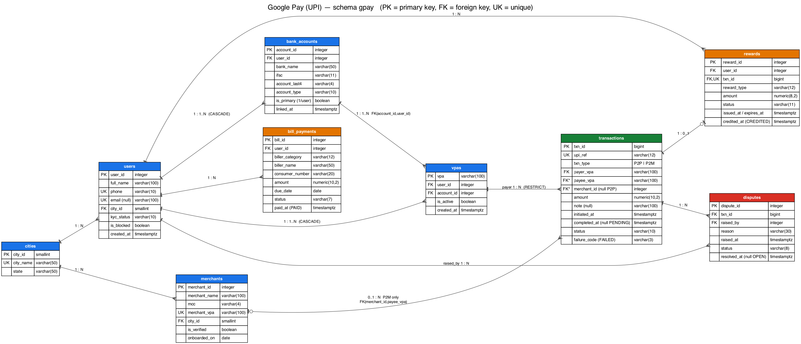
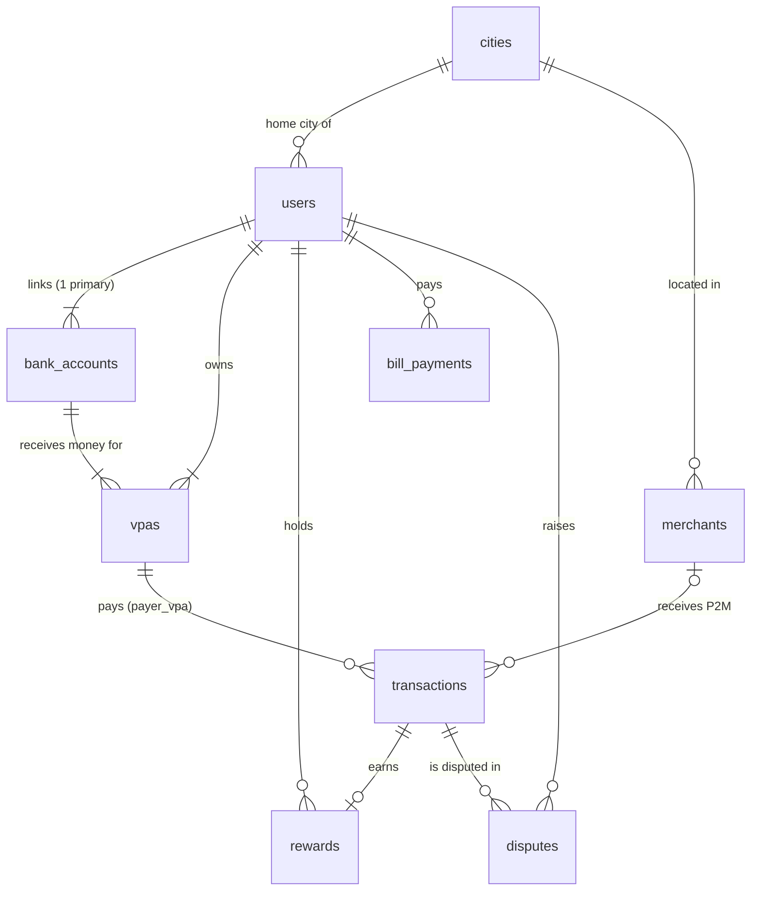

# 02 · Schema Design

**Team T0069** · PostgreSQL 17.12 · schema `gpay` · files: [`sql/01_schema.sql`](../sql/01_schema.sql), [`sql/02_load_data.sql`](../sql/02_load_data.sql), [`diagrams/er_diagram.png`](../diagrams/er_diagram.png)

## 1. How we worked out the schema

1. Loaded every CSV into an all-`text` scratch database and profiled each column: row count, empty count, distinct count, max length, and the full value list for columns with ≤ 15 distinct values.
2. Tested every candidate rule (formats, allowed values, "A ⇔ B" rules between columns, cross-table rules) with `count(*)` queries before turning it into a constraint.
3. Wrote `01_schema.sql`, loaded with `02_load_data.sql`, and ran all 30 workload queries inside `BEGIN … ROLLBACK`. **Every row loads and all 30 queries run unchanged.**

## 2. Data dictionary

Types: integer ids (`smallint` for 10 cities, `bigint` for transactions, which will grow 20–100×); `numeric(p,2)` for money (exact, never `float`); `timestamptz` because every timestamp has a `+05:30` offset; `boolean` for `t/f`; `date` for date-only columns; `varchar(n)` + a `CHECK` for codes. Codes stay strings because they can have leading zeros (`account_last4`, `consumer_number`, MCC) and are never used in arithmetic. Status values are `varchar` + `CHECK IN (…)` instead of `ENUM`, so a new status is a one-line change.

### cities (10 rows)
| Column | Type | Constraint | Why |
|---|---|---|---|
| city_id | smallint | PK | 10 values |
| city_name | varchar(50) | NOT NULL, UNIQUE | natural key; no two cities share a name |
| state | varchar(50) | NOT NULL | Mumbai and Pune share Maharashtra, so not unique |

### users (40,000)
| Column | Type | Constraint | Why |
|---|---|---|---|
| user_id | integer | PK | |
| full_name | varchar(100) | NOT NULL | only 500 distinct names, so not a key |
| phone | varchar(10) | NOT NULL, UNIQUE, CHECK `^[6-9][0-9]{9}$` | UPI sign-up is by mobile number; Indian mobiles start with 6–9 |
| email | varchar(100) | NULL, UNIQUE, CHECK format | **15,950 users have no email.** It is optional at sign-up (only the phone is needed), and missing emails are spread evenly across KYC statuses and sign-up years. |
| city_id | smallint | NOT NULL, FK → cities **RESTRICT** | a city with users must not disappear |
| kyc_status | varchar(10) | NOT NULL, CHECK IN (PENDING, VERIFIED, REJECTED) | |
| is_blocked | boolean | NOT NULL | |
| created_at | timestamptz | NOT NULL | |

### bank_accounts (53,333)
| Column | Type | Constraint | Why |
|---|---|---|---|
| account_id | integer | PK | |
| user_id | integer | NOT NULL, FK → users **CASCADE** | a link has no meaning without its user (in practice deletion is still blocked by RESTRICT on the user's payments) |
| bank_name | varchar(50) | NOT NULL | 8 banks |
| ifsc | varchar(11) | NOT NULL, CHECK `^[A-Z]{4}0[A-Z0-9]{6}$`, CHECK prefix matches bank_name | RBI IFSC format; UTIB = Axis, SBIN = SBI, … (all 53,333 rows match). **Not UNIQUE**: an IFSC is a *branch*, and two customers of one branch share it, even though it happens to be unique in the seed. |
| account_last4 | varchar(4) | NOT NULL, CHECK `^[0-9]{4}$` | masked number with leading zeros, so not an int |
| account_type | varchar(10) | NOT NULL, CHECK IN (SAVINGS, CURRENT) | |
| is_primary | boolean | NOT NULL; **partial UNIQUE (user_id) WHERE is_primary** | at most one primary account per user (a CHECK can't look at other rows) |
| linked_at | timestamptz | NOT NULL | |
| (account_id, user_id) | | UNIQUE | target of the composite FK from `vpas` |

### vpas (53,333)
| Column | Type | Constraint | Why |
|---|---|---|---|
| vpa | varchar(100) | **PK**, CHECK `^[a-z0-9._-]+@[a-z]+$` | the UPI ID is globally unique and is what `transactions` stores, so the text itself is the natural PK (no surrogate needed) |
| user_id | integer | NOT NULL, FK → users CASCADE | |
| account_id | integer | NOT NULL, **FK (account_id, user_id) → bank_accounts (account_id, user_id) CASCADE** | the composite FK enforces "a VPA and its account belong to the same user" |
| is_active | boolean | NOT NULL | 137 inactive |
| created_at | timestamptz | NOT NULL | |

### merchants (3,000)
| Column | Type | Constraint | Why |
|---|---|---|---|
| merchant_id | integer | PK | |
| merchant_name | varchar(100) | NOT NULL | unique in the seed but not by rule (chains) |
| mcc | varchar(4) | NOT NULL, CHECK `^[0-9]{4}$` | ISO 18245 code; can start with 0 (e.g. 0742) |
| merchant_vpa | varchar(100) | NOT NULL, UNIQUE, CHECK format | a merchant collects on its own VPA |
| city_id | smallint | NOT NULL, FK → cities RESTRICT | |
| is_verified | boolean | NOT NULL | |
| onboarded_on | date | NOT NULL | no time part in the data |
| (merchant_id, merchant_vpa) | | UNIQUE | target of the composite FK from transactions |

### transactions (250,468)
| Column | Type | Constraint | Why |
|---|---|---|---|
| txn_id | bigint | PK | will reach millions |
| upi_ref | varchar(12) | NOT NULL, **UNIQUE**, CHECK `^[0-9]{12}$` | NPCI's 12-digit reference: a natural candidate key that support searches by (R24) |
| txn_type | varchar(3) | NOT NULL, CHECK IN (P2P, P2M) | |
| payer_vpa | varchar(100) | NOT NULL, FK → vpas **RESTRICT** | every payer is a GPay user. Payment records must be kept (RBI), so a VPA with payments can't be deleted. |
| payee_vpa | varchar(100) | NOT NULL, CHECK format, **no FK to vpas** | 16,583 P2P payees are on other apps (`@paytm`, `@ibl`, `@axl`, `@ybl`), and P2M payees are merchant VPAs |
| merchant_id | integer | **NULL for P2P**; FK (merchant_id, payee_vpa) → merchants (merchant_id, merchant_vpa) RESTRICT | MATCH SIMPLE: checked only for P2M rows, where it forces payee_vpa = merchant_vpa. SET NULL would break the P2M rule, so RESTRICT. |
| amount | numeric(10,2) | NOT NULL, CHECK `> 0 AND <= 100000` | UPI per-transaction cap ₹1,00,000 (seed: ₹20 – ₹24,999) |
| note | varchar(100) | NULL | optional free text; empty in 70% of rows, for every type and status |
| initiated_at | timestamptz | NOT NULL | |
| completed_at | timestamptz | NULL only while PENDING; CHECK ≥ initiated_at | bank has not answered yet (125 rows) |
| status | varchar(10) | NOT NULL, CHECK IN (PENDING, SUCCESS, FAILED, REVERSED, REFUNDED) | |
| failure_code | varchar(3) | NULL unless FAILED; CHECK IN (U16, U30, U69, XH, Z9, ZM) | NPCI decline codes |

### rewards (39,799)
| Column | Type | Constraint | Why |
|---|---|---|---|
| reward_id | integer | PK | |
| user_id | integer | NOT NULL, FK → users RESTRICT | money owed to a user, so keep it |
| txn_id | bigint | NOT NULL, **UNIQUE**, FK → transactions RESTRICT | one reward per payment (holds for every row) |
| reward_type | varchar(12) | CHECK IN (SCRATCH_CARD, CASHBACK, COUPON) | |
| amount | numeric(8,2) | CHECK ≥ 0 | ₹0.00 = "better luck next time" card |
| status | varchar(11) | CHECK IN (UNSCRATCHED, CREDITED, EXPIRED) | |
| issued_at, expires_at | timestamptz | NOT NULL, CHECK expires_at > issued_at | always 30 days |
| credited_at | timestamptz | NULL unless CREDITED; CHECK between issued_at and expires_at | 8,054 empty = 7,552 EXPIRED + 502 UNSCRATCHED |

### bill_payments (30,000)
| Column | Type | Constraint | Why |
|---|---|---|---|
| bill_id | integer | PK | |
| user_id | integer | NOT NULL, FK → users RESTRICT | payment record |
| biller_category | varchar(12) | CHECK IN (MOBILE, ELECTRICITY, WATER, GAS, BROADBAND, DTH, FASTAG) | |
| biller_name | varchar(50) | NOT NULL | |
| consumer_number | varchar(20) | NOT NULL, CHECK digits only | leading zeros (`0000007919`). **Not UNIQUE**: the same consumer gets a new bill every month. |
| amount | numeric(10,2) | CHECK > 0 | |
| due_date | date | NOT NULL | |
| status | varchar(7) | CHECK IN (DUE, PAID, OVERDUE) | |
| paid_at | timestamptz | NULL unless PAID | 4,338 empty = 1,508 DUE + 2,830 OVERDUE |

### disputes (3,569)
| Column | Type | Constraint | Why |
|---|---|---|---|
| dispute_id | integer | PK | |
| txn_id | bigint | NOT NULL, FK → transactions RESTRICT | **not UNIQUE**: a rejected complaint can be raised again |
| raised_by | integer | NOT NULL, FK → users RESTRICT | |
| reason | varchar(30) | CHECK IN (MONEY_DEBITED_NOT_CREDITED, WRONG_PAYEE, DUPLICATE_PAYMENT, MERCHANT_NOT_DELIVERED, FRAUD) | |
| raised_at | timestamptz | NOT NULL | |
| status | varchar(8) | CHECK IN (OPEN, RESOLVED, REJECTED) | |
| resolved_at | timestamptz | NULL only while OPEN; CHECK > raised_at | 116 open |

### ON DELETE summary
- **CASCADE** only for ownership links with no history value: users → bank_accounts → vpas.
- **RESTRICT** for everything financial (transactions, rewards, bills, disputes) and for the cities lookup. Payment history must be kept for audit, so a user, VPA or merchant with payments cannot be deleted.
- **SET NULL** is not used anywhere: it would break `chk_txn_p2m_merchant` for merchants and lose audit trails elsewhere.

## 3. CHECK constraints (37 in the database; the main ones are grouped below)

| # | Constraint | Rule |
|---|---|---|
| 1 | chk_users_phone | 10-digit Indian mobile |
| 2 | chk_users_email | email format |
| 3 | chk_ba_ifsc | IFSC format `AAAA0XXXXXX` |
| 4 | chk_ba_ifsc_bank | IFSC prefix matches bank name |
| 5 | chk_ba_last4 | exactly 4 digits |
| 6 | chk_vpas_format / chk_merchants_vpa / chk_txn_payee_format | `handle@psp` |
| 7 | chk_merchants_mcc | 4-digit MCC |
| 8 | chk_txn_upi_ref | 12-digit UPI reference |
| 9 | chk_txn_amount | 0 < amount ≤ ₹1,00,000 (UPI cap) |
| 10 | chk_txn_p2m_merchant | P2M ⇔ merchant_id NOT NULL |
| 11 | chk_txn_failed_code | FAILED ⇔ failure_code NOT NULL |
| 12 | chk_txn_failure_code | NPCI codes only |
| 13 | chk_txn_pending_open | PENDING ⇔ completed_at IS NULL |
| 14 | chk_txn_completed_after | completed_at ≥ initiated_at |
| 15 | chk_txn_refund_p2m | REFUNDED only for merchant payments |
| 16 | chk_txn_not_self | payer ≠ payee |
| 17 | chk_rw_credited | CREDITED ⇔ credited_at NOT NULL |
| 18 | chk_rw_expiry / chk_rw_credit_window | expires after issue; credited inside the validity window |
| 19 | chk_bill_paid | PAID ⇔ paid_at NOT NULL |
| 20 | chk_dsp_resolved / chk_dsp_order | OPEN ⇔ resolved_at IS NULL; resolved after raised |
| 21 | allowed-value lists | kyc_status, account_type, txn_type, status (×4), reward_type, biller_category, reason |

Rules that need other rows or tables, which a CHECK can't express, are enforced another way:
- one primary account per user: a partial UNIQUE index
- VPA user = account user: a composite FK
- P2M payee = merchant VPA: a composite FK

All three are also confirmed by the integrity checks in §6.

## 4. Relationships and ER diagram

| Relationship | Cardinality |
|---|---|
| cities → users, cities → merchants | 1 : N |
| users → bank_accounts | 1 : 1..N (26,667 users have 1, 13,333 have 2) |
| bank_accounts → vpas | 1 : 1..N (seed is 1:1, but GPay allows several handles per account) |
| users → vpas | 1 : 1..N |
| vpas → transactions (payer) | 1 : N |
| merchants → transactions | 0..1 : N (only P2M rows; 450 merchants have none) |
| transactions → rewards | 1 : 0..1 (rewards.txn_id UNIQUE) |
| transactions → disputes | 1 : N |
| users → rewards / bill_payments / disputes (raised_by) | 1 : N |

There are no M:N relationships in the stored data. users ↔ merchants is M:N *through* transactions, which acts as the associative entity.

The Mermaid source is in [`diagrams/er_diagram.mmd`](../diagrams/er_diagram.mmd) and the Graphviz source in `diagrams/er_diagram.dot`.

Mermaid code

## 5. Functional dependencies and normal form

Every table has a single-column key (no composite PK), so **2NF holds automatically**: no partial dependencies are possible. For 3NF/BCNF we check that every non-trivial FD has a superkey on the left.

| Table | Functional dependencies | NF |
|---|---|---|
| cities | city_id → city_name, state; city_name → city_id (candidate key) | BCNF |
| users | user_id → all; phone → user_id; email → user_id (candidate keys) | BCNF |
| bank_accounts | account_id → user_id, bank_name, ifsc, account_last4, account_type, is_primary, linked_at. Also **ifsc → bank_name** (the first 4 chars of the IFSC name the bank). | 3NF/BCNF on the stored attributes (see note 1) |
| vpas | vpa → user_id, account_id, is_active, created_at; **account_id → user_id** | 3NF only with the justification in note 2 |
| merchants | merchant_id → all; merchant_vpa → merchant_id | BCNF |
| transactions | txn_id → all; upi_ref → txn_id. For P2M: **merchant_id → payee_vpa** (note 3). | BCNF on keys, with one controlled redundancy |
| rewards | reward_id → all; txn_id → reward_id (candidate key). Also **txn_id → user_id** through the payer. | BCNF (txn_id is a key); user_id is derived (note 4) |
| bill_payments | bill_id → all | BCNF. (biller_name → biller_category *should* hold but doesn't in the data; see §7) |
| disputes | dispute_id → all. raised_by is in practice the payer of txn_id (txn_id → raised_by holds today but is not a rule). | BCNF |

**Notes on derived and redundant columns:**
1. `bank_accounts.bank_name` can be derived from the IFSC prefix. Since `ifsc` is not a key, this is formally a transitive dependency (account_id → ifsc → bank_name). We **keep** bank_name for readability and for the R07/R25 bank reports. Its consistency is guaranteed by `chk_ba_ifsc_bank`, so it cannot drift.
2. `vpas.user_id` is derivable from `vpas.account_id → bank_accounts.user_id` (a transitive dependency). We **keep** it because R01, R03, R14 and R18 filter VPAs by user without joining bank_accounts. The composite FK `(account_id, user_id)` makes inconsistency impossible.
3. For P2M payments, `transactions.payee_vpa` equals `merchants.merchant_vpa`, which is a copy. We **keep** it because payee_vpa is needed anyway for P2P, so one uniform column serves R01, R08 and R09. The composite FK `(merchant_id, payee_vpa)` guarantees the copy is correct.
4. `rewards.user_id` always equals the user who owns the payer VPA of `rewards.txn_id` (integrity check IC4 shows 0 violations). We **keep** it because the rewards tab (R10) and scratch (W03) look up by user and would otherwise need a 3-table join on every app open. It can't drift today because rewards are created by the system, never edited by users. This is a justified denormalization.

## 6. Load results and integrity checks

`psql -d gpay -f sql/01_schema.sql && psql -d gpay -f sql/02_load_data.sql` loads with **no errors**:

| Table | Expected | Loaded |
|---|---:|---:|
| cities | 10 | 10 |
| users | 40,000 | 40,000 |
| bank_accounts | 53,333 | 53,333 |
| vpas | 53,333 | 53,333 |
| merchants | 3,000 | 3,000 |
| transactions | 250,468 | 250,468 |
| rewards | 39,799 | 39,799 |
| bill_payments | 30,000 | 30,000 |
| disputes | 3,569 | 3,569 |

| # | Integrity check | SQL (abridged) | Result |
|---|---|---|---:|
| IC1 | P2M payee VPA = merchant's VPA | `… JOIN merchants USING (merchant_id) WHERE payee_vpa <> merchant_vpa` | **0** violations |
| IC2 | A VPA and its bank account belong to the same user | `vpas JOIN bank_accounts USING (account_id) WHERE b.user_id <> v.user_id` | **0** |
| IC3 | Every user has exactly one primary account | `users WHERE (SELECT count(*) … is_primary) <> 1` | **0** |
| IC4 | rewards.user_id = payer of the rewarded payment | `rewards JOIN transactions JOIN vpas WHERE v.user_id <> r.user_id` | **0** |
| IC5 | Disputes are raised by the payer, after the payment | `… WHERE v.user_id <> raised_by OR raised_at < initiated_at` | **0** |
| IC6 | Rewards only on SUCCESS payments | `rewards JOIN transactions WHERE status <> 'SUCCESS'` | **0** |

We also checked: every PENDING payment was initiated on 30 Jun 2026 after 17:26; completion takes 1–60 s; every `MONEY_DEBITED_NOT_CREDITED` dispute is on a REVERSED payment (1,780 = 1,780); all timestamps are `+05:30`. All 30 queries in `queries/workload_30.sql` run on this schema without modification, and the writes (run inside BEGIN … ROLLBACK) satisfy every constraint.

**Indexes that exist after Phase 2** (only those created by constraints):
- `*_pkey` on every table
- the UNIQUE indexes `cities_city_name_key`, `users_phone_key`, `users_email_key`, `merchants_merchant_vpa_key`, `uq_merchants_id_vpa`, `transactions_upi_ref_key`, `rewards_txn_id_key` and `uq_ba_account_user`
- the partial unique `uq_ba_one_primary_per_user`

None of them is on `transactions(payer_vpa | payee_vpa | merchant_id | status | initiated_at)`, so the baseline is untuned.

## 7. Data problems found

| # | Problem | Evidence | Constraint wrong or data wrong? | Decision |
|---|---|---|---|---|
| D1 | **Biller category does not match biller name.** For example MOBILE → Tata Power / Adani Electricity / FASTag HDFC, WATER → Indane Gas, GAS → Airtel, DTH → Jio, BROADBAND → Tata Play, FASTAG → ACT Fibernet, ELECTRICITY → Delhi Jal Board. | `SELECT biller_category, string_agg(DISTINCT biller_name, ', ') … GROUP BY 1` | **Data problem** | Loaded as is, with no category ↔ biller CHECK because it would reject 100% of rows. Fix: a `billers(biller_name PK, biller_category)` lookup table once the source data is corrected. |
| D2 | **1,298 payments were made by the 192 blocked users.** | `transactions JOIN vpas JOIN users WHERE is_blocked` | Data / business-rule issue (no block date is stored, so they may predate the block) | Loaded. Recommend a `blocked_at` column. |
| D3 | **R13 returns no rows, a wrong answer.** 110,581 P2P rows have `merchant_id IS NULL`, so `merchant_id NOT IN (subquery containing NULL)` is never TRUE. The correct answer is **450** merchants (via `NOT EXISTS`). | `SELECT count(*) FROM merchants m WHERE NOT EXISTS (…)` → 450 | **Query bug**: the NULLs are correct data | To be fixed in Phase 4 (`06_optimized_queries.sql`) |
| D4 | `ifsc` is unique for all 53,333 accounts in the seed, but an IFSC identifies a branch. | 53,333 distinct | Data artefact | Not declared UNIQUE, since it would wrongly block two customers of one branch |
| D5 | VPA handle doesn't match the account's bank (e.g. 20,000 `@okaxis` VPAs vs 6,666 Axis accounts). | `split_part(vpa,'@',2)` counts | Not a problem: in UPI the handle belongs to the PSP bank (Google Pay's partner), not the account's bank | No constraint |
| D6 | 16,583 P2P payees are not in `vpas` (`@paytm` 4,201, `@ibl` 4,186, `@axl` 4,125, `@ybl` 4,071). | anti-join on vpas | Expected (other UPI apps) | `payee_vpa` has a format CHECK but no FK |
| D7 | `users.full_name` has only 500 distinct values across 40,000 users. | profile | Synthetic data; real names repeat | No UNIQUE |
